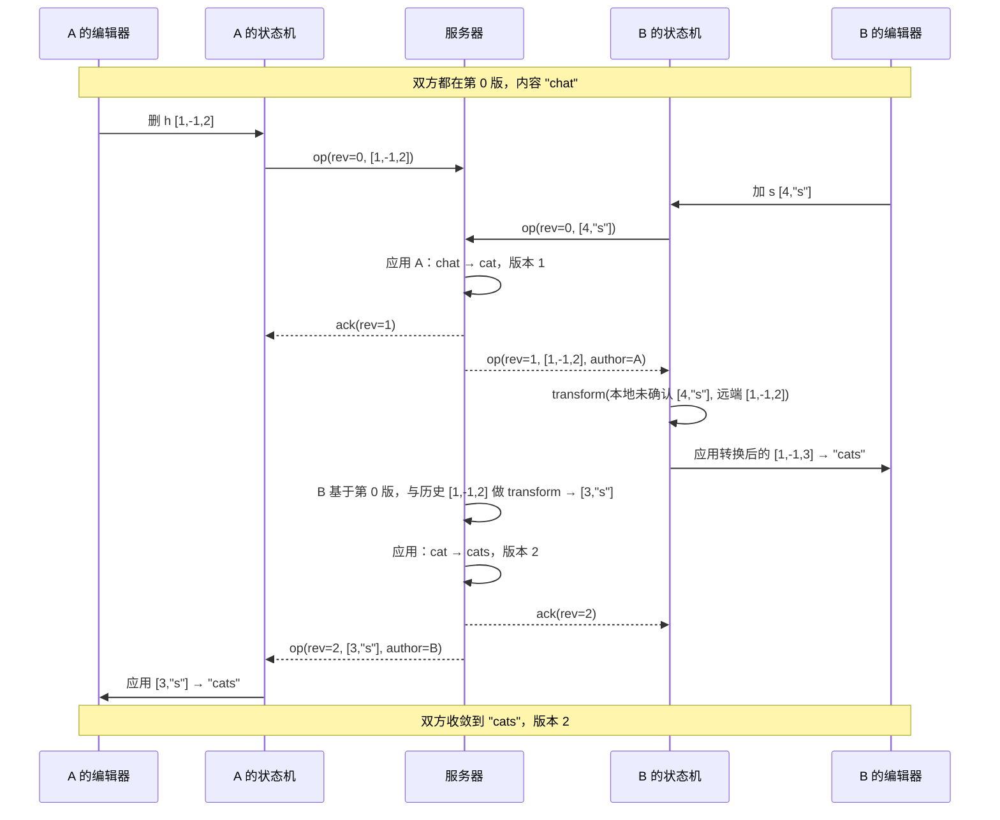

# LonelyCatOD

一个多人实时协同编辑文档的完整实现：Java 后端 + TypeScript 前端（网页与桌面共用一份代码）。

第一版基于 **OT（Operational Transformation，操作转换）** 解决多人同时编辑同一区域的冲突问题。同步层已经抽象成可替换的接口，下一阶段将用 **CRDT** 重做一版做对比。

---

## 目录

- [这个项目要解决什么问题](#这个项目要解决什么问题)
- [核心思路：操作转换](#核心思路操作转换)
- [整体架构](#整体架构)
- [一次按键的完整旅程](#一次按键的完整旅程)
- [技术选型](#技术选型)
- [仓库结构](#仓库结构)
- [快速开始](#快速开始)
- [测试策略](#测试策略)
- [已知限制与后续计划](#已知限制与后续计划)

---

## 这个项目要解决什么问题

多人同时编辑一份文档时，每个人本地看到的内容都在变化，而网络有延迟。如果两个人基于同一个版本各自做了修改，直接把对方的修改照搬到自己这边，结果就会错位。

一个最小的例子。文档内容是 `chat`：

| 用户 | 意图 | 基于原文的操作 | 本地结果 |
|---|---|---|---|
| A | 删掉 `h` | 删除下标 1 的字符 | `cat` |
| B | 在 `t` 后面加 `s` | 在下标 4 插入 `s` | `chats` |

假设 A 的操作先到服务器，文档变成 `cat`。这时 B 的「在下标 4 插入」已经不对了，`cat` 只有 3 个字符。如果强行执行，结果不是越界就是 `cat s`。

反过来 B 那边也一样：B 本地已经是 `chats`，直接执行 A 的「删除下标 1」是对的，但如果 A 的操作是删下标 4 的字符，B 这边就会删错位置。

要保证的性质叫 **收敛**：不管操作以什么顺序到达、不管网络延迟多久，所有人最终看到的文档必须一模一样。这就是本项目要解决的问题。

## 核心思路：操作转换

OT 的想法是：**操作到达时，先根据「它出发之后别人做了什么」调整它的位置，再执行。**

回到上面的例子。B 的操作「在下标 4 插入 s」是基于原文 `chat` 生成的。服务器收到它时已经先执行了 A 的「删除下标 1」。A 删的位置在 B 插入的位置前面，所以 B 的位置要左移 1，变成「在下标 3 插入 s」。在 `cat` 上执行，得到 `cats`。

B 那边收到 A 的操作时做对称的处理：B 的插入在 A 删除位置的后面，对 A 没影响，`delete(1)` 原样执行，`chats` 也变成 `cats`。两边收敛。

这个「调整」就是 `transform` 函数。对任意两个基于同一版本的并发操作 a 和 b，它返回 a' 和 b'，满足：

```
先做 a 再做 b'  ==  先做 b 再做 a'
```

### 操作的表示

真实的编辑一次会改多个字符，所以不用「单字符 + 下标」，而是用业界通用的三原语序列。一个操作从文档开头走到结尾，由这三种组件顺序拼成：

| 组件 | 含义 | 紧凑表示 |
|---|---|---|
| `retain(n)` | 跳过 n 个字符，不改 | 正整数 `n` |
| `insert(s)` | 在当前位置插入字符串 | 字符串 `"s"` |
| `delete(n)` | 删除当前位置之后的 n 个字符 | 负整数 `-n` |

于是上面两个操作分别是：

```
A 删 h：      [1, -1, 2]      跳过 c，删 1 个，跳过 at
B 加 s：      [4, "s"]        跳过 chat，插入 s
```

这也是网络上传输的格式。`transform(A, B)` 会把 B 转成 `[3, "s"]`，把 A 转成 `[1, -1, 3]`。

### 版本号与服务器

每个客户端提交操作时都带上「我基于第几版」。服务器保留操作历史，收到一个基于第 r 版的操作时，依次和第 r 版之后的每个历史操作做 `transform`，把它一步步「搬」到最新版本上，然后应用、加版本号、持久化、广播给其他人。

客户端同一时刻最多只有一个操作在途（等待服务器确认）。等待期间用户继续输入的内容用 `compose` 合并成一个 buffer，收到确认后再发。这个约束让服务器和客户端的转换逻辑都保持简单。

## 整体架构

```
┌──────────────────────────┐        ┌──────────────────────────┐
│   lonelycat-client       │        │   lonelycat-server       │
│                          │        │   (Spring Boot, :9090)   │
│  ┌────────────────────┐  │        │                          │
│  │ CodeMirror 6 编辑器 │  │        │  ┌────────────────────┐  │
│  └─────────┬──────────┘  │        │  │ CollabWebSocket    │  │
│            │ 事务 ↔ 操作  │        │  │ Handler  /ws       │  │
│  ┌─────────▼──────────┐  │        │  └─────────┬──────────┘  │
│  │ packages/editor    │  │        │            │             │
│  └─────────┬──────────┘  │        │  ┌─────────▼──────────┐  │
│            │ SyncAdapter │        │  │ DocumentSession    │  │
│  ┌─────────▼──────────┐  │  WS    │  │ 服务器端 transform  │  │
│  │ packages/sync      │◄─┼────────┼─►│ 版本号 / 历史       │  │
│  │ OtClient 三状态机   │  │  JSON  │  └─────────┬──────────┘  │
│  └─────────┬──────────┘  │        │            │             │
│            │             │        │  ┌─────────▼──────────┐  │
│  ┌─────────▼──────────┐  │        │  │ DocumentService    │  │
│  │ packages/ot-core   │  │        │  │ 操作日志 + 快照     │  │
│  │ transform/compose  │  │        │  └─────────┬──────────┘  │
│  └────────────────────┘  │        │            │             │
│                          │        │  ┌─────────▼──────────┐  │
│  apps/web (Vite)         │  REST  │  │ ot-core            │  │
│  apps/desktop (Electron) │◄───────┼─►│ transform/compose  │  │
└──────────────────────────┘        │  └────────────────────┘  │
                                    │        H2 数据库          │
                                    └──────────────────────────┘
```

两端各有一份 OT 算法库（Java 和 TypeScript），逻辑逐行对应，并跑同一份测试向量保证行为一致。前后端之间只有两样契约：WebSocket 消息格式（[`lonelycat-server/PROTOCOL.md`](lonelycat-server/PROTOCOL.md)）和测试向量文件。

## 一次按键的完整旅程



具体分五步：

1. **编辑器把改动变成操作。** CodeMirror 的事务描述了「旧文档哪一段被替换成什么」，`changesToOperation` 从左到右扫一遍，生成 retain / delete / insert 序列。
2. **客户端状态机决定发不发。** 三个状态：`Synchronized`（无在途操作，立即发）、`AwaitingConfirm`（有一个在等确认，新编辑攒进 buffer）、`AwaitingWithBuffer`（确认后把 buffer 整体发出）。
3. **服务器把操作搬到最新版本。** 与基于版本之后的每个历史操作做 `transform`，应用，写操作日志，广播。
4. **其他客户端应用远端操作。** 先与本地未确认的 outstanding 做 `transform`，再与 buffer 做 `transform`，得到能直接作用于本地编辑器的操作。
5. **操作回到编辑器。** `operationToChanges` 转回 CodeMirror 事务，带上「远端」标记避免回环。远端光标位置随每个事务用 CodeMirror 的位置映射自动调整。

## 技术选型

| 层 | 选择 | 为什么 |
|---|---|---|
| 冲突解决 | OT，ot.js 风格的三原语模型 | 中心服务器模型直观，便于理解「版本号 + 转换」的原理；后续用 CRDT 对比 |
| 后端 | Java 17，Spring Boot 3，原生 WebSocket | 不用 STOMP，协议自己定更清楚；`TextWebSocketHandler` 足够 |
| 持久化 | H2 文件库，JPA | 零安装即可运行；操作日志表 + 定期快照，重启后从快照重放恢复。换 PostgreSQL 只改配置 |
| 前端编辑器 | CodeMirror 6 | 事务模型天然适合「改动 → 操作」的转换，有成熟的装饰 API 画远端光标 |
| 前端壳 | React 19 + Tailwind CSS v4 | 2026-10-19 从原生 TS 重写；深浅双主题（CSS 变量）、组件全手写不引组件库；算法/同步/编辑器三包零改动 |
| 前端构建 | Vite，npm workspaces | 内部包直接以 TS 源码互相引用，无需预编译 |
| 桌面端 | Electron | 直接加载网页构建产物，一份代码两端跑；无边框窗口 + 主题化窗口控制按钮，与网页 UI 一体（`titleBarOverlay` + preload 桥） |
| 同步层抽象 | `SyncAdapter` 接口 | 编辑器只依赖接口，`OtSyncAdapter` 可被 `YjsSyncAdapter` 整体替换 |

## 仓库结构

```
LonelyCatOD/
├─ lonelycat-server/                Java 后端（Maven 多模块）
│  ├─ ot-core/                      纯算法库：TextOperation、OtEngine，零 Spring 依赖
│  ├─ server-app/                   Spring Boot：WebSocket、会话、持久化、REST
│  ├─ scripts/e2e-smoke.mjs         用真实 WebSocket 复现 chat → cats 的端到端脚本
│  ├─ PROTOCOL.md                   前后端消息契约
│  └─ README.md
└─ lonelycat-client/                TypeScript 前端（npm workspaces）
   ├─ packages/ot-core/             与 Java 版一一对应的 OT 库
   ├─ packages/sync/                OtClient 状态机、OtSyncAdapter、SyncAdapter 接口
   ├─ packages/editor/              CodeMirror 6 桥接、远端光标
   ├─ apps/web/                     Vite 网页壳：文档列表 + 编辑页
   ├─ apps/desktop/                 Electron 壳
   └─ README.md
```

两个项目各自独立构建，互不引用源码。

## 快速开始

环境：JDK 17、Maven 3.9、Node 22+。

```bash
# 1. 后端（终端 1）
cd lonelycat-server
mvn install
java -jar server-app/target/server-app-0.1.0-SNAPSHOT.jar      # 监听 9090

# 2. 网页（终端 2）
cd lonelycat-client
npm install
npm run dev:web                                                 # http://localhost:5173

# 3. 桌面端（可选，需要 dev:web 已在运行）
npm run dev:desktop
```

打开两个浏览器窗口进同一个文档，互相打字即可看到实时同步和对方光标。

后端地址默认 `http://localhost:9090`，指向其他机器时在 `lonelycat-client/apps/web/.env.local` 写 `VITE_SERVER_URL=http://<ip>:9090`。

## 测试策略

OT 最怕的是「大部分情况对，某个边角错」，所以测试分三层：

| 层 | 做法 | 位置 |
|---|---|---|
| 共享向量 | 手写典型场景（同位置同时插入、删除区间重叠、在别人删除的区间里插入等），Java 与 TS 跑同一份 JSON | `ot-core/src/test/resources/ot-test-vectors.json`，`packages/ot-core/test/ot-test-vectors.json` |
| 随机性质 | 随机文档 + 随机操作，验证 `transform` 收敛、`compose` 等价于顺序应用、`invert` 能撤销 | 两端各 500 到 2000 轮 |
| 端到端 | 内存模拟服务器 + 三个客户端随机交错 50 轮；真实 WebSocket 连接复现 chat → cats；CodeMirror 事务与操作随机往返 | `packages/sync/test`，`scripts/e2e-smoke.mjs`，`packages/editor/test` |

```bash
cd lonelycat-server && mvn test
cd lonelycat-client && npm test
node lonelycat-server/scripts/e2e-smoke.mjs      # 需要后端已启动
```

## 已知限制与后续计划

**第一版的限制**

- 单实例部署。多实例需要把文档会话固定到某台机器，或用 Redis 广播操作。
- 没有登录和权限，任何人可打开任何文档。
- 断线重连时，本地尚未确认的操作会丢失。
- 内存中的操作历史只保留从本次加载以来的部分，版本落后于快照的客户端会被要求重新加入。

**后续计划**

1. **CRDT 版本。** 实现 `YjsSyncAdapter` 替换 `OtSyncAdapter`，后端增加 Yjs update 的中转与存储，编辑器层不动。两种方案在同一套 UI 下对比。为什么先 OT 后 CRDT 的完整技术分析见 [`docs/ot-to-crdt.md`](docs/ot-to-crdt.md)。
2. 鉴权与文档权限。
3. 富文本（标题、加粗等）：把操作模型从纯文本扩展为带属性的 rich-text 类型。
4. 多实例与水平扩展。
